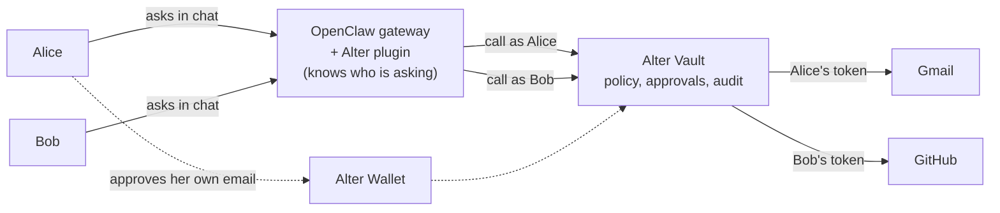

# @alter-ai/openclaw-plugin

**One OpenClaw agent for your whole team, where everyone acts as themselves.**

[OpenClaw](https://github.com/openclaw/openclaw) gives your team a capable
agent in Slack and the other channels it supports. Sharing one agent raises
questions a single-user setup never has to answer: whose Gmail does it read,
whose name does it post under, who approved that email, and how do you cut off
someone who left? This plugin answers them with [Alter](https://alterauth.com).
Each person signs in and connects their own accounts, and the agent acts as
**the person who asked**, with that person's access, approvals and audit
trail.

> **Status:** 0.x — early. The security primitives (AAD-bound at-rest
> encryption, App SDK chokepoint, HMAC-signed Connect state with grant-id
> ownership check, identity-collision rejection, per-user approval lock) are
> built and tested; sign-in is Alter-hosted, through any identity provider
> Alter supports.

## Why Alter

A shared agent usually runs on one set of credentials. Alter replaces that
with per-person identity, credentials, approvals and audit:

| | One agent, one set of credentials | With the Alter plugin |
|---|---|---|
| **Whose account it uses** | Whoever set the agent up. Everyone in the channel reads and sends as that person. | The person who asked. Alice's request uses Alice's Gmail; Bob's uses Bob's. |
| **Where provider tokens live** | On the gateway host, in its config or environment. | In Alter Vault. Alter adds the credential and makes the call, so provider tokens never reach the gateway. |
| **Writes** (send, post, create, cancel) | Run as soon as the model decides to. | Wait for the requester's approval in their Alter Wallet. Policy can require more than one approver. |
| **Audit** | Gateway logs, if any. | Each person's own activity log in the Alter Wallet. The gateway logs approvals and errors against a hashed user ID, never the person's name. |
| **Revoking access** | Rotate the shared credential, for everyone. | A person revokes one connection from chat or the Wallet. Deprovisioning someone in your identity provider, synced to Alter, ends their access. |
| **Onboarding** | An admin wires up credentials. | People sign in and connect accounts themselves, from one-click links in chat. |
| **Spend** | One budget for everyone. | A daily token cap per person. |
| **Memory** | One memory for everyone who talks to the agent. | Each person's own memory, keyed on their verified identity. |

## How it works



1. **Sign in once.** The first time someone asks for something, the agent
   replies with a one-time link. They sign in on Alter's hosted page with your
   identity provider (Okta, Auth0, Clerk, WorkOS, or another OIDC provider).
2. **Connect their own accounts.** When a request needs a provider they
   haven't connected, they get a connect link for it (or type `/alter connect`
   for a menu). The provider's consent screen runs through Alter; the gateway
   never sees the tokens.
3. **Ask.** The agent calls tools as that person. Reads run right away.
4. **Approve writes.** Anything that sends, posts, creates or cancels waits for
   the requester to approve it in their Alter Wallet. Alter then runs it, and
   the person asks again for the result.

## Who sees and does what

Say Alice, Bob and Carol all talk to the same agent, in a shared `#team`
channel and in direct messages.

| Situation | What happens |
|---|---|
| Alice, in `#team`: "email the Q3 summary to the board" | The email goes from **Alice's** Gmail, after **Alice** approves it in her Wallet. |
| Bob: "what's on my calendar today?" | He gets **Bob's** calendar. If he hasn't connected Google yet, he gets his own connect link. |
| Carol hasn't signed in and asks for anything | She gets a sign-in link. Until then she can't use anyone's connections, including Alice's or Bob's. |
| Bob: "approve Alice's email" | He can't. The approval is Alice's (plus any approvers your policy adds), and in a group DM Bob never even sees her approval link. |
| Alice leaves and is deprovisioned in your identity provider | Her next request is refused. Nobody has to rotate a shared password. (Needs Alter's identity-provider deprovisioning set up.) |

**Separate for every person**, enforced on every call from their verified
sign-in:

- identity: their chat account is linked to their own Alter user
- connected accounts: Bob's requests can never reach Alice's Gmail, Slack or
  GitHub
- approvals: a write waits for the requester, plus any approvers your policy
  names, never for whoever else is in the conversation
- daily token cap
- memory (`alter_memory_*` tools)
- activity log and connections, in their own Alter Wallet

**Shared by everyone in a conversation:**

- everything said in a channel or group DM, including the agent's replies. If
  Alice asks for her calendar in `#team`, everyone in `#team` sees the answer.
- the model's context for that conversation: anyone in it can ask the agent
  about earlier messages.
- the gateway itself, and the LLM provider key it runs on (the operator's
  bill).

Private requests belong in a direct message, with OpenClaw's
`session.dmScope` set to `per-channel-peer` so each person's DMs are their own
conversation. The reference deployment sets it. The full breakdown is in
[docs/MULTI_USER_LIMITS.md](./docs/MULTI_USER_LIMITS.md).

## What your team can do

Each person uses their own connected account. One Google connection covers
Gmail, Calendar and Drive.

| Provider | Ask things like | Reads | Writes (need approval) |
|---|---|---|---|
| Gmail | "find the contract email from Acme and summarize it" · "tell Dana the review moved to 3pm" | search, read messages | send email |
| Google Calendar | "what's on my calendar tomorrow?" · "book 30 minutes with Carol on Friday" | list events | create events |
| Google Drive | "find the latest budget spreadsheet" | search, file details | — |
| Slack | "what did people say about the launch in #eng?" · "post the standup summary to #team" | search messages | post messages |
| GitHub | "open bugs in acme/widgets" · "file an issue for the login crash" | search issues and PRs | create issues, comment |
| Linear | "what are my open Linear issues?" · "create an issue for the flaky test" | search issues | create issues |
| Notion | "find the onboarding doc" · "add a page under Meeting Notes" | search | create pages |
| Calendly | "who booked time with me this week?" · "send a link for a 30-minute call" · "cancel tomorrow's 2pm" | profile, event types, scheduled events, invitees | create scheduling links, cancel events |
| LinkedIn | "show my recent posts" · "share this announcement" | profile, posts | share posts |
| X | "show my latest posts" · "post this update" | profile, recent posts | post |
| Web search (Tavily) | "search the web for the latest OpenClaw release" | search | — |
| Memory | "remember that I prefer short answers" · "what do you remember about me?" · "forget that" | recall | remember, forget (only your own; no approval) |

Approval for writes is enforced by your Alter policy (set `requires_approval`
on write-capable grants); see "Known security caveats" below.

People rarely need slash commands, because the agent offers sign-in and
connect links when a request needs them. They exist for checking and managing
things directly:

| Command | Does |
|---|---|
| `/alter connect` | Menu of one-click connect links for every provider |
| `/alter connect <provider>` | Connect one provider (e.g. `gmail`, `linkedin`) |
| `/alter connections` | List your active connections |
| `/alter connections revoke <id>` | Revoke one of them |
| `/alter wallet` | Open your Alter Wallet: activity log, connections, approvals |
| `/alter status` | Show your sign-in state and any pending approval |
| `/alter status clear` | Clear a stuck pending approval |
| `/alter login` | Sign in again manually (rarely needed) |

**[docs/USER_GUIDE.md](./docs/USER_GUIDE.md)** is a short guide for the people
on your team; share it when you roll the agent out.

The tool list lives in `src/tools/registry.ts` (mirrored in
`openclaw.plugin.json` `contracts.tools`). Adding a tool is a ~30-line file
using `registerAlterTool` (see `src/tools/web-search.ts` for the smallest
example), so anything Alter has a provider for can be exposed this way.

## Install

```sh
# in your OpenClaw deployment dir
openclaw plugins install @alter-ai/openclaw-plugin
# or local checkout:
openclaw plugins install ./openclaw-alter-plugin
```

Requires Node ≥ 22 (uses the `node:sqlite` built-in). On boot, you'll see
`ExperimentalWarning: SQLite is an experimental feature` — that's Node telling
you `node:sqlite` is still flagged experimental in 22-24. It works, and the
warning will go away when Node graduates the API.

See **[OPERATOR_SETUP.md](./OPERATOR_SETUP.md)** for the full provisioning
recipe (Alter app and API keys, identity provider, provider integrations,
env vars, plugin config). Reading that doc end-to-end is the only way to
actually run this plugin.

## Deploy to Slack or Discord

The reference deployment ([deploy/fly/README.md](./deploy/fly/README.md))
runs the gateway on one Fly.io machine and connects it to Slack, Discord, or
both. Each platform turns on when its secrets are set; the next boot installs
OpenClaw's plugin for it and enables it, with team-ready defaults and private
per-person DMs.

| Platform | Secrets | Guide |
|---|---|---|
| Slack (Socket Mode, no public webhook) | `SLACK_BOT_TOKEN`, `SLACK_APP_TOKEN` | [Phase 2a](./deploy/fly/README.md#phase-2a--slack-socket-mode) |
| Discord | `DISCORD_BOT_TOKEN` | [Phase 2b](./deploy/fly/README.md#phase-2b--discord) |

Running OpenClaw somewhere else? [OPERATOR_SETUP.md step 9](./OPERATOR_SETUP.md#step-9--connect-slack-or-discord)
covers the same setup by hand. `bash deploy/fly/smoke-test.sh` boots the
image in Docker for each setup before you deploy a change.

## Architecture in one paragraph

`src/index.ts` exports a `definePluginEntry({register})`. The `register`
callback installs the `/alter/connect/cb` HTTP route, slash commands, the
`llm_output` rate-limit hook, an operator CLI surface (`openclaw alter
login|enable-tools|db-rotate-key|rotate-state-hmac|unlink-channel-user`), and
one tool factory per tool. Each factory closes over
`ctx.{sessionId, messageChannel, requesterSenderId}` (trusted, runtime-provided
by OpenClaw) and returns an `AnyAgentTool`. The tool's `execute()` runs the
identity gate against `(messageChannel, requesterSenderId)` — looking up an
encrypted JWT in SQLite, checking the per-day rate-limit, finding the right
grant, then calling Alter via `agent.proxyRequest({grantId, …})`. Sign-in is
Alter-hosted: a user without a session gets a one-time link from
`App.createAuthSession`, and a background poller stores the token Alter returns.
HITL prompts set a `pendingApprovalLock`, keyed per session *and* user; until
the approval resolves, that user's further tool calls in the session return
the pending link (other participants are unaffected).

## Security guarantees

Each is implemented and unit-tested in `tests/`:

- **At-rest encryption with AAD binding.** Identity JWTs are stored
  AES-256-GCM encrypted with `(channel_kind, channel_user_id, row_id)` bound
  into the AAD. A SQLite-write attacker who swaps two ciphertext rows fails
  GCM authentication on the next read. (`tests/crypto.test.ts`.)
- **App SDK chokepoint.** The `App` instance is wrapped in a Proxy that
  refuses `listGrants` / `revokeGrant` / `revokeDelegation` whenever no user
  JWT is in `currentUserJwt` AsyncLocalStorage scope. A stray refactor that
  forgot `currentUserJwt.run(jwt, …)` throws loudly instead of silently
  cross-user-listing.
- **HMAC-signed Connect state with grant ownership check.** `/alter connect`
  signs an HMAC payload binding `(csrfNonce, sessionId, channelKind,
  channelUserId, appUserId, provider, iat, ttl)`. The callback verifies the
  HMAC, consumes a single-use csrfNonce row, AND verifies the
  newly-created grant actually belongs to the bound `appUserId` (it must
  appear in that user's own grant list for the provider, created since the
  state was minted) before persisting.
- **Identity-collision rejection.** Re-link with the same IdP `sub` updates
  the JWT (last-write-wins is fine within an identity); re-link with a
  *different* `sub` for the same `(channel_kind, channel_user_id)` is
  REJECTED rather than silently re-pointing grants. (`tests/identity-store.test.ts`.)
- **Alter-verified sign-in.** The user's token comes from
  `App.pollAuthSession` and is verified by Alter server-side (signature,
  issuer, audience, expiry, signing-key rotation). The plugin only decodes
  `sub` and `exp` locally, and re-prompts sign-in once `exp` passes or Alter
  rejects the token.
- **Per-user approval lock.** The pending-approval lock is keyed
  `(session_id, app_user_id)` and consulted only after identity resolves, so
  in a shared group DM one participant never sees another's wallet link.
  (`tests/approval-lock-cross-user.test.ts`.)
- **Byte-aware tool-result truncation.** `capToolResultJson` measures UTF-8
  bytes (not UTF-16 code units), caps lists, and always emits parseable JSON
  with a `{truncated, truncatedReason, partial}` envelope.

### Known security caveats

Read these before pointing the plugin at real users:

- **HITL is enforced as a _post_-check, not a pre-check.** The Alter SDK does
  not expose a grant's `requires_approval` policy on `OAuthGrantItem`, so the
  plugin cannot block a write *before* it executes. For an `hitl: true` tool it
  verifies *after* the call that `proxyRequest` returned a `PendingApproval`; if
  the server-side policy is missing `requires_approval`, the irreversible action
  has **already run** by the time the plugin logs the violation and drops the
  grant cache. **The real gate is the server-side Alter policy** — set
  `requires_approval` on every write-capable grant in the Alter portal, and
  alert on the `HITL VIOLATION` ERROR log line.
- **Process-local state.** Rate-limit buckets, the in-flight `listGrants`
  coalescer, and the per-session approval lock are per-process. A multi-replica
  gateway needs a shared store; today the gate assumes a single gateway process.
- **No silent IdP refresh.** Expired JWTs re-prompt sign-in rather than refresh.
- **Some backend error text reaches the agent.** Policy-violation and
  invalid-request messages from Alter, and an approved action's execution
  error, are relayed to the LLM so it can tell the user accurately; this
  assumes those messages are user-safe. Other 4xx/5xx detail goes only to the
  gateway log.

Found a vulnerability? See **[SECURITY.md](./SECURITY.md)** — please don't open
a public issue.

## Build / test

```sh
pnpm install
pnpm build          # tsc → dist/
pnpm typecheck
pnpm test           # vitest — unit tests covering the security primitives
```

## Limitations (0.x)

These are **explicit non-goals** for now:

- **No auto-resume after HITL.** After approving in the wallet, the user asks
  again; the plugin checks the approval's status. (`/alter status clear`
  clears a lock that is stuck.)
- **No silent IdP refresh.** When a JWT expires, user is re-prompted to sign
  in. A refresh-token flow is not implemented yet.
- **No per-user LLM billing.** OpenClaw's model-provider plugin holds one
  LLM key; the operator pays for all LLM calls.
- **No MCP server mode.** The whole identity gate is built around OpenClaw's
  session/channel model; MCP transports need a different identity binding.
  Deferred.
- **Per-day rate-limit only** (no per-minute). The counter increments
  post-call so per-day caps tolerate the burst at the cap edge.

## Files

- `src/` — TypeScript source. `src/index.ts` is the composition root; stores
  live in `src/identity/`, `src/grants/`, `src/rate-limit/`; crypto in
  `src/crypto/`; the central tool wrapper in `src/tools/base.ts`.
- `tests/` — vitest unit tests for the security primitives.
- `openclaw.plugin.json` — manifest (id, configSchema with
  `additionalProperties: false`).
- `OPERATOR_SETUP.md` — provisioning recipe (read this before installing).

## License

MIT.
